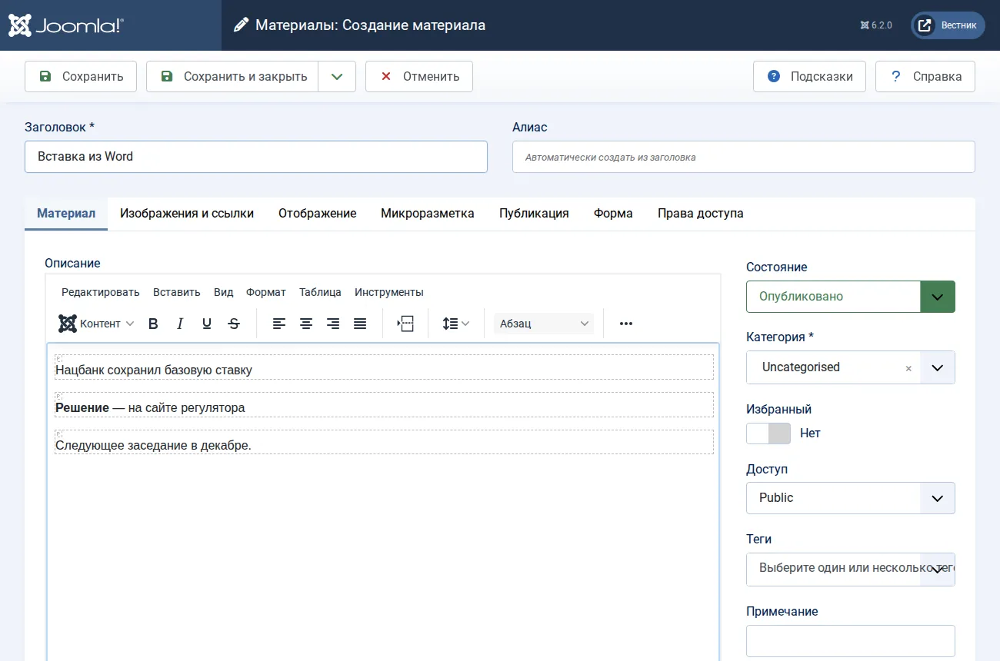
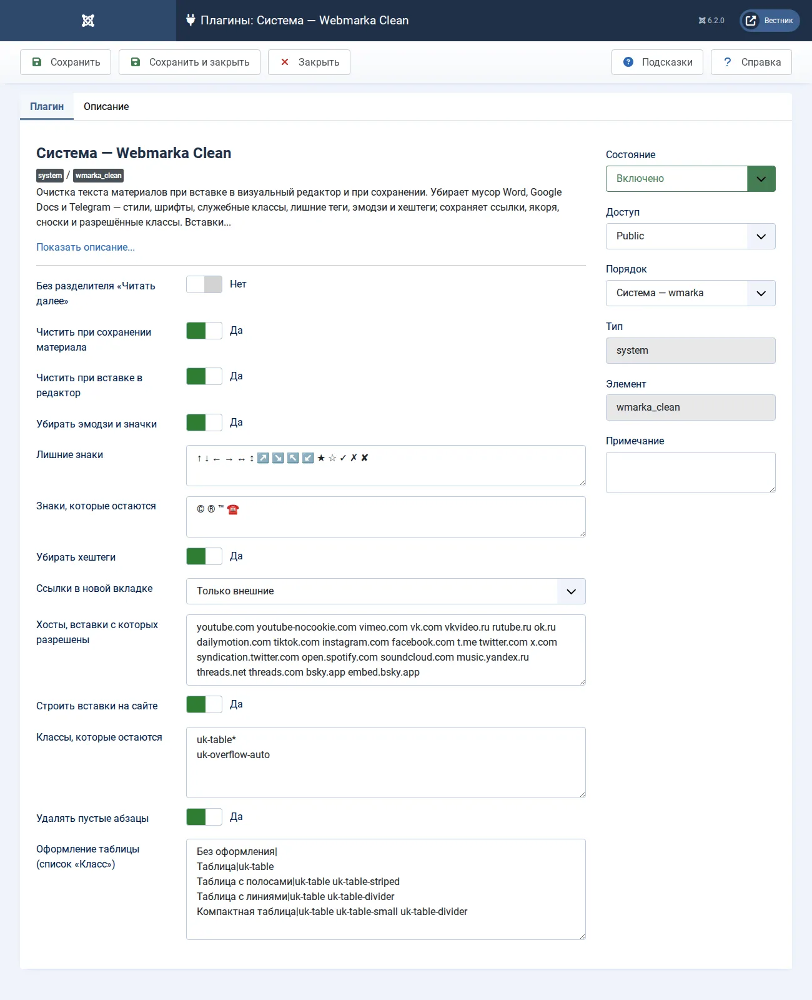

# Webmarka Clean

[Русский](README.ru.md) · [English](README.md)

Мақала мәтінін визуалды редакторға қойғанда және сақтағанда тазалайтын Joomla 6 плагині. Материалдарды Word, Google Docs, LibreOffice және Telegram-нан көшіретін редакцияларға арналған: стильдер, қаріптер, қызметтік кластар, бос жолдар, эмодзи мен хэштегтер алынады, ал сілтемелер, якорьлар, ескертпелер, тізімдер мен кестелер қалады.

Видео мен әлеуметтік желі ендірмелерін плагин мәтінде қауіпсіз белгі ретінде сақтайды — оны iframe-ге тыйым салатын Joomla мәтін сүзгілері өткізеді — және сайтта одан нағыз ендірмені өзі құрады. Шаблонға бұл үшін ештеңе білудің қажеті жоқ.

> Скриншоттар мен Joomla мәзірлерінің атаулары әкімшілік бөлімнің орыс тіліндегі нұсқасынан алынған.

## болғаны және болатыны

Word пен Telegram-нан қойылған мәтін:

```html
<p class="MsoNormal" style="margin:0cm;line-height:150%"><span style="font-family:Calibri">Нацбанк сохранил базовую ставку 🔥</span><o:p></o:p></p>
<p class="MsoNormal"><span style="mso-spacerun:yes">&nbsp;</span></p>
<p class="MsoNormal"><b>Решение</b> — на сайте регулятора ✅<br>Следующее заседание в декабре.</p>
<p>#экономика #ставка</p>
```

Редакторға қойғаннан кейін — дерекқорға дәл осы сақталады:

```html
<p>Нацбанк сохранил базовую ставку</p>
<p><strong>Решение</strong> — на сайте регулятора</p>
<p>Следующее заседание в декабре.</p>
```



## не істейді

- **Кеңсе бағдарламаларының қоқысы.** Word түсініктемелері мен шартты блоктары, `<o:p>` сияқты тегтер, `span` пен `font` (мазмұны қалады; стильдегі қалың және көлбеу қаріп `strong` пен `em` болады), барлық `style`, `lang`, `align`, қызметтік `id` және рұқсат етілгеннен басқа барлық кластар. Word тізімдері нағыз `ul` мен `ol` болады.
- **Абзацтар.** `<br>` арқылы бөлінген жолдар жеке абзац болады, бос абзацтар мен артық бос орындар алынады.
- **Эмодзи, белгішелер мен хэштегтер** — мәтіннен, тақырыптан және мета-сипаттамадан. Валюта белгілері (₸ ₽ $ € £ ¥ және басқалар), №, §, градус, ± × ≈ ‰, бөлшектер, © ® ™, сан алдындағы минус, тізім белгілері мен жалғыз «*» ескертпе белгісі қалады. «Қалатын белгілер» тізімін әр сайт өзі толықтырады — мысалы, байланыс үшін ☎ пен ✉, рейтинг үшін ★.
- **Сілтемелер.** Якорьлар мен ескертпелер сақталады; сыртқы сілтемелер қалауыңызша жаңа қойындыда ашылады.
- **Ендірмелер.** Рұқсат етілген хосттардың iframe-і (YouTube, Vimeo, VK, Rutube, TikTok, Instagram, Facebook, Telegram, X, Spotify, Datawrapper, Flourish және Infogram диаграммалары және басқалар), Telegram жазбасының виджеті және сценарийлі Flourish пен Infogram блоктары белгі ретінде сақталады; басқа хосттардың iframe-і жойылады. Сайтта белгі кешіктіріп жүктелетін бейімделгіш iframe-ге айналады, ал әлеуметтік желі дәйексөздеріне сол желінің скрипті тек осындай дәйексөзі бар беттерде қосылады.
- **Wmarka Media белгіленуі.** Wmarka Media фототекасынан қойылған сурет (`figure.wm-figure`, кадр авторы — `span.wm-figure__credit` ішінде), оның «Бейне» батырмасымен қойылған бейне (`figure.wm-figure--video`, ролик мекенжайы — `data-wm-video`, атауы — `data-wm-title`) және Файлотекадағы құжатқа сілтеме (`a.wm-doc wm-doc--pdf`) баптау қандай кластарға рұқсат берсе де өз кластары мен деректерін сақтайды; басқа элементтердегі осындай кластар мен `data-wm-*` әдеттегідей алынады.

Бір ережелер екі рет жұмыс істейді: браузерде қою кезінде — көрінгені сақталатынымен бірдей болуы үшін, және серверде сақтау кезінде — демек, «Код» арқылы қою, импорт, API мен Webmarka MCP сияқты ассистенттер арқылы түзету кезінде де.

## орнату

1. «Система → Установка расширений» мәзіріндегі «Установить по URL» қойындысын ашыңыз.
2. Мекенжайды қойып, орнату батырмасын басыңыз:

   ```
   https://github.com/bsakhanov/plg_system_wmarka_clean/releases/download/v1.0.0/plg_system_wmarka_clean_v1.0.0.zip
   ```

Плагин өзі қосылады. «The Tenge: очистка текста» плагині тұрған сайтта оның баптаулары көшіріледі, ал мәтін екі рет тазаланбас үшін ол өшіріледі.

## баптаулар

«Система → Плагины → Жүйе — Webmarka Clean».



- **Мақаланы сақтағанда тазалау** — Серверде дәл сол ережелер жұмыс істейді: «Код» арқылы, басқа редактордан қойғанда, импорт кезінде, API мен ассистенттер арқылы түзеткенде де.
- **Редакторға қойғанда тазалау** — Word немесе Telegram-нан қойылған мәтінді редактор бірден қоқыссыз көрсетеді: көрінгені сақталатынымен бірдей.
- **Эмодзи мен белгішелерді алып тастау** — Барлық эмодзи (смайликтер, ым-ишара, заттар, жалаушалар, жақтаудағы сандар, ✅ ❗ ⚡ және Unicode-тың басқа пиктограммалары), «Артық белгілер» тізіміндегі белгілер және қатар тұрған «**» мақаланың мәтінінен, тақырыбынан және сипаттамасынан — редакторға қойғанда да, сақтағанда да алынады. Валюта белгілері (₸ ₽ $ € £ ¥ және басқалар), №, §, градус °, ± × ≈ ‰, бөлшектер, тізім белгілері (● ◉ ⬤ • және абзац басындағы сызықша), жалғыз «*» (ескертпе белгісі), сан алдындағы минус «−» және «Қалатын белгілер» тізіміндегі белгілер қалады.
- **Артық белгілер** — Эмодзиден бөлек мәтіннен алынатын белгілер, бос орын арқылы. Әдепкіде — ↑ ↓ ← → ↔ ↕ ↗ ↘ ↖ ↙ көрсеткілері және жазбалардағы ★ ☆ ✓ ✗ ✘ белгішелері. Өріс бос болса, тек эмодзи алынады.
- **Қалатын белгілер** — Ешқашан алынбайтын белгілер — эмодзи ретінде де, артық белгілер тізімінен де; бос орын арқылы. Әдепкіде © ® ™: Unicode оларды пиктограмма деп санайды, ал мәтінде бұлар авторлық құқық пен тауар белгісінің таңбалары. Мысалы, байланыс үшін ☎ ✉, рейтинг үшін ★ қосыңыз. Валюта белгілері, №, §, градус, ± × ≈ ‰ және бөлшектер эмодзи емес, олар бәрібір қалады. Мәтіндегі «©️» «©» болады.
- **Хэштегтерді алып тастау** — Мәтін соңындағы хэштегтер мен тек хэштегтерден тұратын жолдар толық алынады; сөйлем ішінде тек «#» алынады да, сөз қалады.
- **Сілтемелер жаңа қойындыда** — Мақала мәтініндегі сілтемелерге target=_blank және rel=noopener қосылады. «#Якорьлар» (ескертпелер, мазмұн), mailto мен tel сол қойындыда қалады.
- **Ендіруге рұқсат етілген хосттар** — Видео, әлеуметтік желі және диаграмма ендірмелері (YouTube, TikTok, Instagram, Facebook, Telegram, X, Threads, Datawrapper, Flourish, Infogram және басқалар): осы хосттардың (бос орын арқылы, субдомендер де кіреді) мекенжайы бар iframe мәтінде Joomla сүзгілері өткізетін қауіпсіз белгі ретінде сақталады, ал сайтта плагин одан нағыз ендірме құрады. Басқа хосттардың iframe-і жойылады.
- **Сайтта ендірмелерді құру** — Мақала мәтініндегі ендірме белгілерін плагин сайтта нағыз ендірмеге — рұқсат етілген хосттардың кешіктіріп жүктелетін iframe-іне — айналдырады, ал әлеуметтік желі дәйексөздері үшін сол желінің скриптін қосады. Ендірмелерді шаблон құратын болса, өшіріңіз.
- **Қалатын кластар** — Әр жолға бір үлгі, «*» — кез келген соңы. Басқа кластардың бәрі (соның ішінде MsoNormal, MsoTableGrid) алынып тасталады. Әдепкіде — UIkit 3 кесте кластары; Bootstrap негізіндегі шаблонға table* қосыңыз.
- **Бос абзацтарды жою** — Мәтіні, суреті, сілтемесі мен кестесі жоқ абзацтар (Word бос жолдарды осылай береді).
- **Кестенің безендірілуі («Класс» тізімі)** — Әр жолға бір нұсқа: «Атауы|кластар». Редактордағы кесте қасиеттері терезесінде көрсетіледі.
- **«Толығырақ» бөлгішісіз** — Сақтағанда кіріспе мен негізгі мәтін бір өріске біріктіріліп, `<hr id="system-readmore">` сызығы алынады, ал анонс ұзындық баптауларымен қиылады. Әдепкіде өшірулі.

## жаңартулар

Жаңа нұсқалар «Система → Обновления» бетіне келеді: жаңарту сервері осы репозиторийде (`updates.xml`), мұрағаттар — оның шығарылымдарында.

## әзірлеушілерге

`./build.sh` `dist/` қалтасын жинайды; `php tests/test_cleaner.php` тазалағыш пен ендірме құрушыны Joomla-сыз тексереді; `tools/release.sh` нұсқаны шығарады (`--dry-run` ештеңе жарияламайды). Тазалағыш (`src/Cleaner/WordClean.php`) Joomla-ға тәуелді емес, оның редакторға арналған айнасы — `media/js/paste.js`; сайттағы ендірмелерді `src/Embed/Renderer.php` құрады.

Негізі — The Tenge сайтының мәтін тазалау плагині. Лицензия — GNU GPL 2-нұсқасы немесе одан кейінгі нұсқасы. Авторы — Бейбіт Саханов, [webmarka.kz](https://webmarka.kz).
