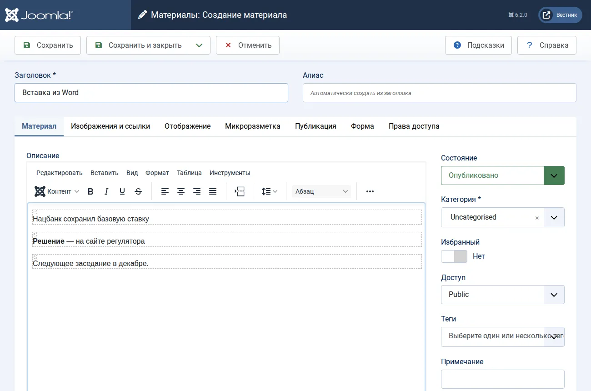
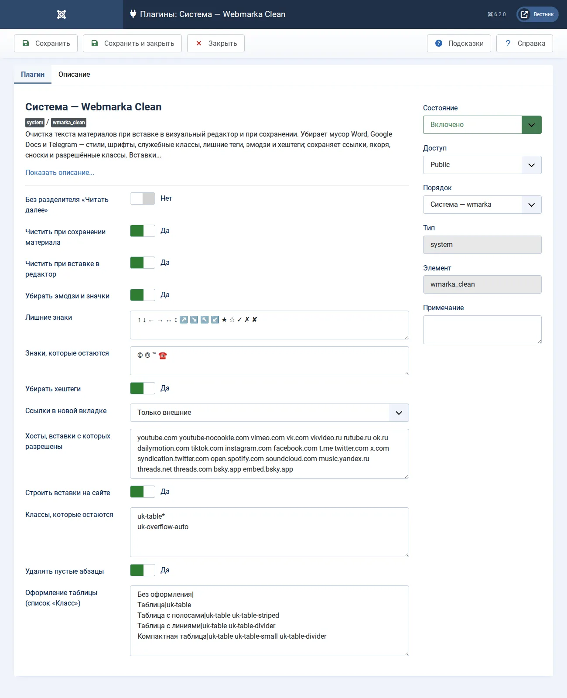

# Webmarka Clean

[Русский](README.ru.md) · [Қазақша](README.kk.md)

A Joomla 6 plugin that cleans article text — on paste into the visual editor and on save. For newsrooms that bring copy over from Word, Google Docs, LibreOffice and Telegram: styles, fonts, service classes, empty lines, emoji and hashtags go; links, anchors, footnotes, lists and tables stay.

Video and social embeds are stored in the text as a safe marker that Joomla's text filters (which forbid iframes) let through, and the plugin builds the real embed from it on the site. The template does not need to know anything about it.

## Before and after

Pasted from Word and Telegram:

```html
<p class="MsoNormal" style="margin:0cm;line-height:150%"><span style="font-family:Calibri">Нацбанк сохранил базовую ставку 🔥</span><o:p></o:p></p>
<p class="MsoNormal"><span style="mso-spacerun:yes">&nbsp;</span></p>
<p class="MsoNormal"><b>Решение</b> — на сайте регулятора ✅<br>Следующее заседание в декабре.</p>
<p>#экономика #ставка</p>
```

In the editor right after pasting — exactly what is saved:

```html
<p>Нацбанк сохранил базовую ставку</p>
<p><strong>Решение</strong> — на сайте регулятора</p>
<p>Следующее заседание в декабре.</p>
```



## What it does

- **Office clutter.** Word comments and conditional blocks, tags such as `<o:p>`, `span` and `font` (content kept; bold and italic from styles become `strong` and `em`), every `style`, `lang`, `align`, service `id` and every class except the allowed ones. Word lists become real `ul` and `ol`.
- **Paragraphs.** Lines separated by `<br>` become paragraphs; empty paragraphs and extra spaces go.
- **Emoji, symbols and hashtags** — from the text, title and meta description. Currency signs (₸ ₽ $ € £ ¥ and others), №, §, the degree sign, ± × ≈ ‰, fractions, © ® ™, the minus before a number, list markers and a single footnote «*» stay. Each site extends the «Symbols to keep» list itself — for example ☎ and ✉ for contacts or ★ for ratings.
- **Links.** Anchors and footnotes are kept; external links can open in a new tab.
- **Embeds.** Iframes of allowed hosts (YouTube, Vimeo, VK, Rutube, TikTok, Instagram, Facebook, Telegram, X, Spotify and others) and the Telegram post widget become markers; iframes of other hosts are removed. On the site a marker becomes a responsive, lazy-loaded iframe, and social quotes get their platform script — only on pages that have such a quote.

The same rules run twice: in the browser on paste, so what you see is what is saved, and on the server on save — so they also cover text inserted through «Code», imports, and edits through the API and assistants such as Webmarka MCP.

## Installation

1. System → Install → Extensions, tab «Install from URL».
2. Paste the address and press the install button:

   ```
   https://github.com/bsakhanov/plg_system_wmarka_clean/releases/download/v1.0.0/plg_system_wmarka_clean_v1.0.0.zip
   ```

The plugin enables itself. On a site that used «The Tenge: text cleaning», its settings are carried over and that plugin is disabled so the text is not cleaned twice.

## Options

System → Plugins → System — Webmarka Clean.



- **Clean on save** — The same rules on the server: they also apply to text inserted through «Code», from another editor, on import, and to edits made through the API and assistants.
- **Clean on paste** — The editor shows text pasted from Word or Telegram already clean: what you see is what will be saved.
- **Remove emoji and symbols** — All emoji (faces, gestures, objects, flags, keycaps, ✅ ❗ ⚡ and any other Unicode pictograph), the symbols of the «Extra symbols» list and repeated «**» are removed from the text, title and description of an article, on paste and on save. Currency signs (₸ ₽ $ € £ ¥ and others), №, §, the degree sign °, ± × ≈ ‰, fractions, list markers (● ◉ ⬤ • and a dash at the start of a paragraph), a single «*» (footnote mark), the minus «−» before a number and the symbols of the «Symbols to keep» list stay.
- **Extra symbols** — Symbols removed besides emoji, separated by spaces. By default the arrows ↑ ↓ ← → ↔ ↕ ↗ ↘ ↖ ↙ and the post decorations ★ ☆ ✓ ✗ ✘. Empty: only emoji are removed.
- **Symbols to keep** — Symbols that are never removed — neither as emoji nor by the extra symbols list; separated by spaces. By default © ® ™: Unicode counts them as pictographs, while in text they are the copyright and trademark signs. Add, for example, ☎ ✉ for contacts or ★ for ratings. Currency signs, №, §, the degree sign, ± × ≈ ‰ and fractions are not emoji and stay anyway. «©️» in the text becomes «©».
- **Remove hashtags** — Hashtags at the end of the text and lines of hashtags only are removed entirely; inside a sentence only the «#» goes and the word stays.
- **Links in a new tab** — Links in the article text get target=_blank and rel=noopener. «#Anchors» (footnotes, contents), mailto and tel stay in the same tab.
- **Hosts allowed for embeds** — Video and social embeds (YouTube, TikTok, Instagram, Facebook, Telegram, X, Threads and others): an iframe of these hosts (space-separated, subdomains included) is stored in the text as a safe marker that Joomla text filters let through, and the plugin builds the real embed from it on the site. Iframes of other hosts are removed.
- **Build embeds on the site** — On the site the plugin turns embed markers in article text into real embeds — lazy-loaded iframes of allowed hosts — and loads the platform script for social quotes. Turn it off if your template builds embeds itself.
- **Classes to keep** — One pattern per line, «*» matches any ending. All other classes (MsoNormal, MsoTableGrid included) are removed. By default the table classes of UIkit 3; for a Bootstrap template add table*.
- **Remove empty paragraphs** — Paragraphs without text, image, link or table (this is how Word passes empty lines).
- **Table styles (the «Class» list)** — One option per line: «Title|classes». Shown in the table properties dialog of the editor.
- **Without the «Read more» divider** — On save the intro and full text are joined into one field and the `<hr id="system-readmore">` line is removed; the teaser is cut by length settings. Off by default.

## Updates

New versions arrive in System → Update: the update server is this repository (`updates.xml`), the archives are in its releases.

## Development

`./build.sh` builds `dist/`; `php tests/test_cleaner.php` checks the cleaner and the embed renderer without Joomla; `tools/release.sh` publishes (`--dry-run` publishes nothing). The cleaner (`src/Cleaner/WordClean.php`) has no Joomla dependencies; its mirror for the editor is `media/js/paste.js`; embeds on the site are built by `src/Embed/Renderer.php`.

Based on the text cleaning plugin of The Tenge. License: GNU GPL version 2 or later. Author: Beibit Sakhanov, [webmarka.kz](https://webmarka.kz).
