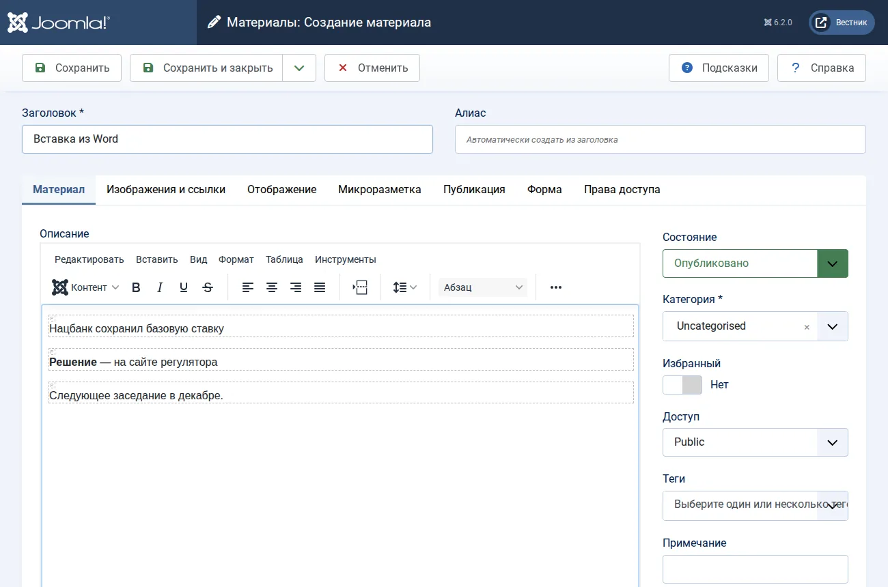
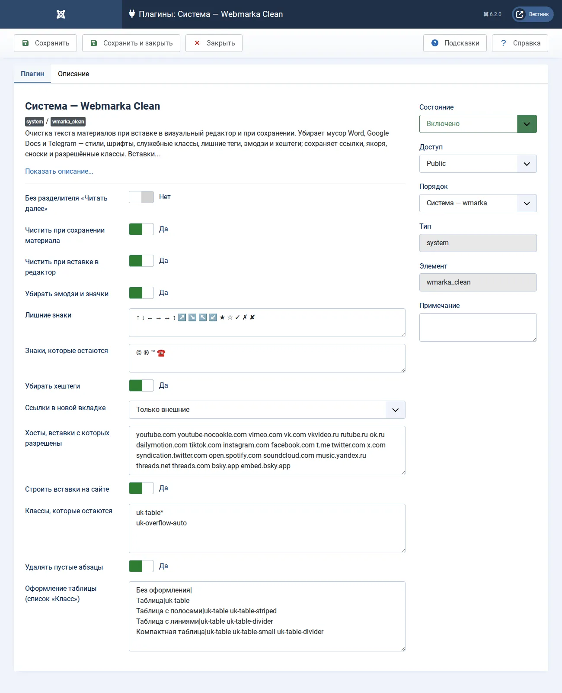

# Webmarka Clean

[English](README.md) · [Қазақша](README.kk.md)

Плагин для Joomla 6, который чистит текст статей — при вставке в визуальный редактор и при сохранении. Для редакций, которые переносят материалы из Word, Google Docs, LibreOffice и Telegram: стили, шрифты, служебные классы, пустые строки, эмодзи и хештеги уходят, а ссылки, якоря, сноски, списки и таблицы остаются.

Вставки видео и соцсетей плагин хранит в тексте безопасной меткой — её пропускают фильтры текста Joomla, запрещающие iframe, — и сам строит из неё настоящую вставку на сайте. Шаблону для этого ничего уметь не нужно.

## было и стало

Вставка из Word и Telegram:

```html
<p class="MsoNormal" style="margin:0cm;line-height:150%"><span style="font-family:Calibri">Нацбанк сохранил базовую ставку 🔥</span><o:p></o:p></p>
<p class="MsoNormal"><span style="mso-spacerun:yes">&nbsp;</span></p>
<p class="MsoNormal"><b>Решение</b> — на сайте регулятора ✅<br>Следующее заседание в декабре.</p>
<p>#экономика #ставка</p>
```

После вставки в редактор — то же, что сохранится в базе:

```html
<p>Нацбанк сохранил базовую ставку</p>
<p><strong>Решение</strong> — на сайте регулятора</p>
<p>Следующее заседание в декабре.</p>
```



## что делает

- **Мусор офисных программ.** Комментарии и условные блоки Word, теги вроде `<o:p>`, `span` и `font` (содержимое остаётся; жирный и курсив из стилей становятся `strong` и `em`), все `style`, `lang`, `align`, служебные `id` и все классы, кроме разрешённых. Списки Word становятся настоящими `ul` и `ol`.
- **Абзацы.** Строки через `<br>` становятся отдельными абзацами, пустые абзацы и лишние пробелы уходят.
- **Эмодзи, значки и хештеги** — из текста, заголовка и мета-описания. Остаются знаки валют (₸ ₽ $ € £ ¥ и другие), №, §, градус, ± × ≈ ‰, дроби, © ® ™, минус перед числом, знаки списков и одиночная «*» сноски. Список «Знаки, которые остаются» каждый сайт дополняет сам — например, ☎ и ✉ для контактов или ★ для рейтингов.
- **Ссылки.** Якоря и сноски сохраняются; внешние ссылки по выбору открываются в новой вкладке.
- **Вставки.** iframe разрешённых хостов (YouTube, Vimeo, VK, Rutube, TikTok, Instagram, Facebook, Telegram, X, Spotify и другие) и виджет поста Telegram хранятся меткой; iframe других хостов удаляются. На сайте метка становится адаптивным iframe с отложенной загрузкой, а для цитат соцсетей подключается скрипт площадки — только на тех страницах, где такая цитата есть.
- **Разметка Wmarka Media.** Снимок из фототеки Wmarka Media (`figure.wm-figure`, автор кадра — в `span.wm-figure__credit`), видео её кнопки «Видео» (`figure.wm-figure--video` с адресом ролика в `data-wm-video` и названием в `data-wm-title`) и ссылка на документ из Файлотеки (`a.wm-doc wm-doc--pdf`) сохраняют свои классы и данные, какие бы классы ни разрешала настройка; те же классы и `data-wm-*` у других элементов снимаются, как обычно.

Одни и те же правила работают дважды: в браузере при вставке, чтобы видимое совпадало с сохранённым, и на сервере при сохранении — значит, и при вставке через «Код», импорте, правках через API и ассистентов вроде Webmarka MCP.

## установка

1. «Система → Установка расширений», вкладка «Установить по URL».
2. Вставьте адрес и нажмите кнопку установки:

   ```
   https://github.com/bsakhanov/plg_system_wmarka_clean/releases/download/v1.0.0/plg_system_wmarka_clean_v1.0.0.zip
   ```

Плагин включается сам. На сайте, где стоял плагин «The Tenge: очистка текста», его настройки переносятся, а он выключается, чтобы текст не чистился дважды.

## настройки

«Система → Плагины → Система — Webmarka Clean».



- **Чистить при сохранении материала** — Тот же набор правил на сервере: сработает и при вставке через «Код», из другого редактора, при импорте, и на правках через API и ассистентов.
- **Чистить при вставке в редактор** — Редактор сразу показывает вставленный из Word или Telegram текст без мусора: то, что видно, совпадает с тем, что сохранится.
- **Убирать эмодзи и значки** — Убираются все эмодзи (смайлы, жесты, предметы, флаги, цифры в рамке, ✅ ❗ ⚡ и любые другие пиктограммы Unicode), знаки из списка «Лишние знаки» и «**» подряд — из текста, заголовка и описания материала, при вставке в редактор и при сохранении. Остаются знаки валют (₸ ₽ $ € £ ¥ и другие), №, §, градус °, ± × ≈ ‰, дроби, обозначения списков (● ◉ ⬤ • и тире в начале абзаца), одиночная «*» (знак сноски), минус «−» перед числом и знаки из списка «Знаки, которые остаются».
- **Лишние знаки** — Знаки, которые, кроме эмодзи, убираются из текста; через пробел. По умолчанию — стрелки ↑ ↓ ← → ↔ ↕ ↗ ↘ ↖ ↙ и значки ★ ☆ ✓ ✗ ✘ из постов. Пустое поле — убираются только эмодзи.
- **Знаки, которые остаются** — Знаки, которые не убираются никогда — ни как эмодзи, ни из списка лишних знаков; через пробел. По умолчанию © ® ™: Unicode считает их пиктограммами, а в тексте это знаки авторского права и товарных марок. Допишите, например, ☎ ✉ для контактов или ★ для рейтингов. Знаки валют, №, §, градус, ± × ≈ ‰ и дроби эмодзи не считаются и остаются и так. «©️» в тексте становится «©».
- **Убирать хештеги** — Хештеги в конце текста и строки из одних хештегов убираются целиком; внутри предложения (рубрику #ЧитаемКниги — …) убирается только «#», слово остаётся.
- **Ссылки в новой вкладке** — В тексте материала ссылки получают target=_blank и rel=noopener. «#Якоря» (сноски, оглавление), mailto и tel остаются в той же вкладке.
- **Хосты, вставки с которых разрешены** — Вставки соцсетей и видео (YouTube, TikTok, Instagram, Facebook, Telegram, X, Threads и другие): iframe с адресом этих хостов (через пробел, поддомены включены) сохраняется в тексте безопасной меткой — её пропускают фильтры текста Joomla, — а на сайте плагин строит из неё настоящую вставку. iframe с других хостов удаляется.
- **Строить вставки на сайте** — Метки вставок в тексте статьи плагин на сайте превращает в настоящие вставки — iframe разрешённых хостов с отложенной загрузкой, — а для цитат соцсетей подключает скрипт площадки. Выключите, если вставки строит шаблон.
- **Классы, которые остаются** — По одному шаблону в строке, «*» — любое окончание. Все остальные классы (в том числе MsoNormal, MsoTableGrid) убираются. По умолчанию — табличные классы UIkit 3; для шаблона на Bootstrap добавьте table*.
- **Удалять пустые абзацы** — Абзацы без текста, картинки, ссылки и таблицы (так Word передаёт пустые строки).
- **Оформление таблицы (список «Класс»)** — По одному варианту в строке: «Название|классы». Показывается в окне свойств таблицы в редакторе.
- **Без разделителя «Читать далее»** — При сохранении введение и основной текст склеиваются в одно поле, черта `<hr id="system-readmore">` убирается, а анонс режется настройками длины. По умолчанию выключено.

## обновления

Новые версии приходят в «Система → Обновления»: сервер обновлений лежит в этом репозитории (`updates.xml`), архивы — в его выпусках.

## разработка

- `./build.sh` — пакет, `SHA256SUMS.txt` и `updates.xml` в `dist/`.
- `php tests/test_cleaner.php` — проверки очистителя и построения вставок без Joomla.
- `tools/release.sh` — метка, выпуск с архивом и суммами, затем `updates.xml` в `main`; `--dry-run` ничего не публикует.
- Очиститель (`src/Cleaner/WordClean.php`) от Joomla не зависит, его зеркало для редактора — `media/js/paste.js`; построение вставок на сайте — `src/Embed/Renderer.php`.

Основа — плагин очистки текста сайта The Tenge. Лицензия — GNU GPL версии 2 или более поздней. Автор — Бейбит Саханов, [webmarka.kz](https://webmarka.kz).
